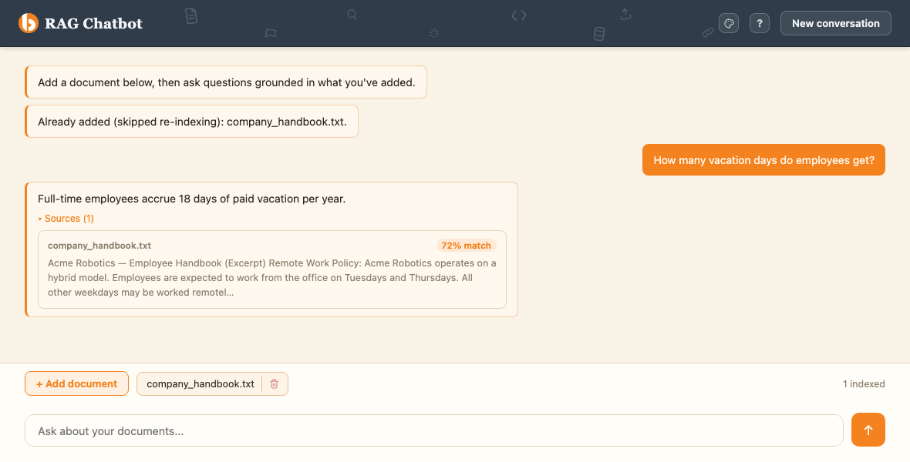

<div align="center">

# RAG Chatbot

Upload your own documents and ask questions about them — answers are grounded in
what you actually uploaded, with the exact source passages shown alongside every
reply.

**Runs entirely on your machine** - the index, your documents' text and the
embedding cache all live in a local `data/` folder. No database, no hosting.

</div>

<br>



## What it does

- **Upload** `.txt`, `.md`, or `.pdf` files (drag-and-drop or the file picker).
- **Ask questions** about them in plain conversation - replies stay grounded in
  your documents rather than the model's own general knowledge, and honestly
  say "I don't have that information" when nothing relevant was uploaded.
- **See the receipts.** Every grounded answer has an expandable **Sources**
  panel showing exactly which passage it came from, which file, and how
  strong the match was - so you're never just taking the answer on faith.
- **Multiple documents, no duplicates.** Upload as many files as you like;
  re-uploading the same content (even under a different filename) is
  detected and skipped rather than indexed twice.
- **5 color themes**, a clean conversation history that persists between
  visits, and a "New conversation" button that gives you a genuinely clean
  slate (chat + documents both cleared).

## How it works

```
upload → extract text → chunk → embed (Gemini, cached on disk) → store (local Chroma index)
                                                        ↓
your question → embed → similarity search → relevant chunks → grounded answer (Gemini)
```

Built with **Python + FastAPI** on the backend, **LangChain + Google Gemini**
for chat and embeddings, a **local Chroma** vector index (plus a small JSON
document registry and a SQLite embedding cache, all under `data/`), and a
**vanilla HTML/CSS/JS** frontend - no frontend framework, no build step.
Gemini is the only external service; nothing is deployed.

> **Roadmap:** the app is gaining a **mode switch** between this standard RAG
> and three document-specific RAGs (plain-text reports, long structured
> reports, and tables/charts/footnotes) - see Part 2 of
> [docs/phases.md](docs/phases.md).

For the full technical write-up (architecture, schema, API contract, and
how each part was built and verified), see [docs/](docs/) - start with
[docs/architecture.md](docs/architecture.md). Current build status/phase
tracking lives in [docs/progress.md](docs/progress.md).

## Running it yourself

```bash
python3 -m venv .venv
source .venv/bin/activate
pip install -r requirements.txt

# Put GOOGLE_API_KEY (and optionally CHAT_MODEL) in .env.local - that's the
# only credential needed. See docs/setup.md for the full list.

uvicorn app.main:app --reload --port 8000
# -> open http://localhost:8000
```

```bash
pytest
# Offline tests (store, embedding cache, engine) need no key. The smoke tests
# make real Gemini calls and need GOOGLE_API_KEY. Tests use a throwaway data
# folder, never your real library.
```
